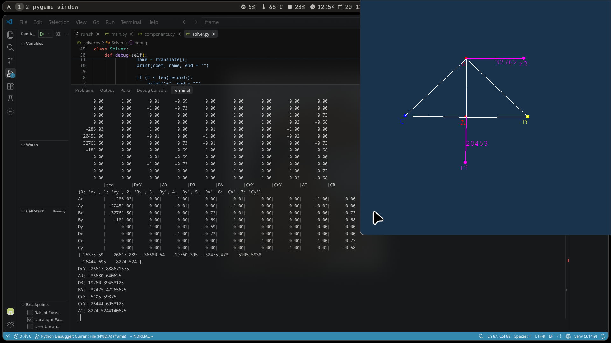
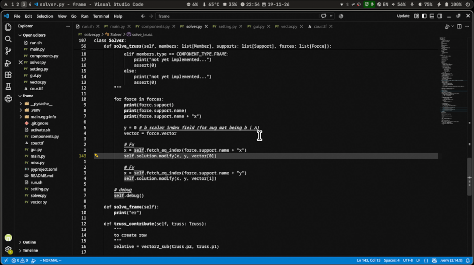

# truss_calc_MEC115
given a drawn structure and couple of forces, analyze tensions 

17/11/26: start the project
- proposing the algorithm, strategy for calculating trusses
  - data abstraction, hierarchy for components
  - some premature overhead planing for the future
- refining the calculating model

20/11/26: done trusses
- working toward computing frame and truss structures

# Notes
No AI generated codes are used in this repo

Ignore the .vscode and the venv folders
Pygame coordinate is flipped (intuitively, that should not affect the tension force in each member)

The code architecture decisions (except the solver) are mostly based on on-the-fly assumptions. This is not a healthy codebase.  